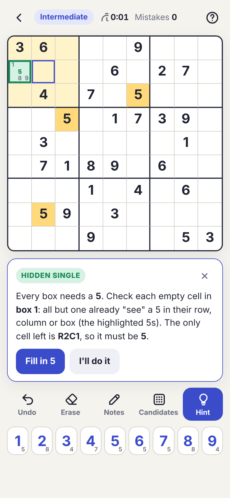
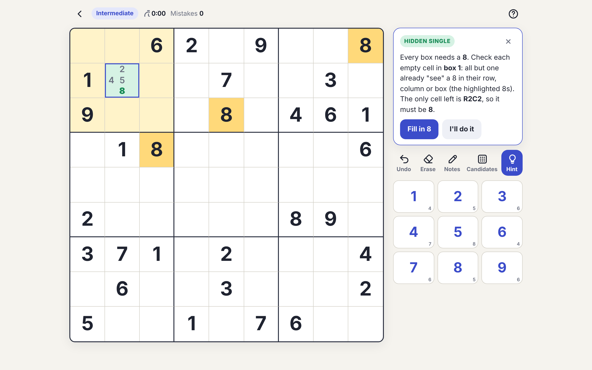

# Sudoku Coach

A responsive Sudoku game that guides you **step by step**. Choose **Easy**, **Intermediate** or **Difficult**,
and whenever you're stuck the coach shows you where to look, explains the logic, and lets you fill in the answer.

It's a Progressive Web App (PWA): one codebase that runs in any modern browser and installs like a native app on
Android, iPhone/iPad, Windows, macOS, Linux and ChromeOS, with offline play.

<p>
  
  
</p>

## Features
- **Difficulty levels**: every puzzle is generated fresh, has exactly one solution, and is graded by the techniques needed
  - Easy: about 38 clues, singles only
  - Intermediate: about 30 clues, needs pairs, pointing and box/line reduction
  - Difficult: 24–28 clues, needs X-Wing, Y-Wing or "what if" reasoning
- **Step-by-step coach**: a nudge first, then a full explanation with highlighted cells and crossed-out candidates, then an optional fill-in. It catches wrong entries before they cause trouble.
- **11 techniques taught**: Hidden/Naked Single, Pointing Pair/Triple, Box/Line Reduction, Naked Pair/Triple, Hidden Pair, X-Wing, Y-Wing, Forcing
- Pencil notes, auto-candidates, undo, mistake counter, timer, auto-save, dark mode, keyboard shortcuts
- Works offline after the first visit (service worker)

## Play online
After GitHub Pages is enabled (see below), the game is live at
`https://<your-username>.github.io/sudoku-coach/`.
Open it on Android in Chrome and choose **⋮ → Install app**. On iPhone, use Safari → **Share → Add to Home Screen**.

## Run locally
```bash
npm start        # serves on http://localhost:8080 (needs Python 3)
npm test         # generates puzzles at each level and solves them using only the coach's hints
```
You can also just open `index.html` in a browser.

## Deployment
Every push to `main` runs the tests and publishes the site to GitHub Pages via
`.github/workflows/deploy.yml`. If the first run fails at the Pages step, go to
**Settings → Pages → Build and deployment → Source: GitHub Actions** and re-run the workflow.

Other hosting options, plus how to package for Google Play / the App Store with Capacitor, are in
[docs/DEPLOYMENT.md](docs/DEPLOYMENT.md).

## Project structure
```
index.html            The whole app: UI + puzzle engine (generator, grader, hint coach)
manifest.json         PWA metadata (name, icons, colours)
sw.js                 Service worker for offline play
icons/                App icons (standard, maskable, Apple touch)
tests/                Headless engine tests (Node.js, no dependencies)
docs/                 Screenshots and deployment guide
.github/workflows/    CI: test + deploy to GitHub Pages
```

## Releasing an update
Bump `CACHE` in `sw.js` (e.g. `sudoku-coach-v2`) so installed apps pick up the new version.
